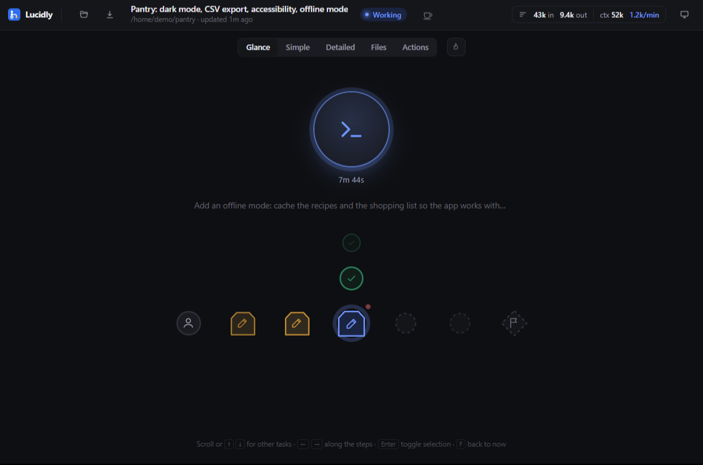
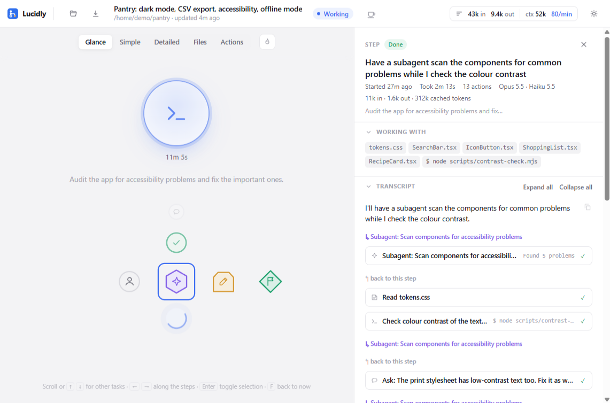
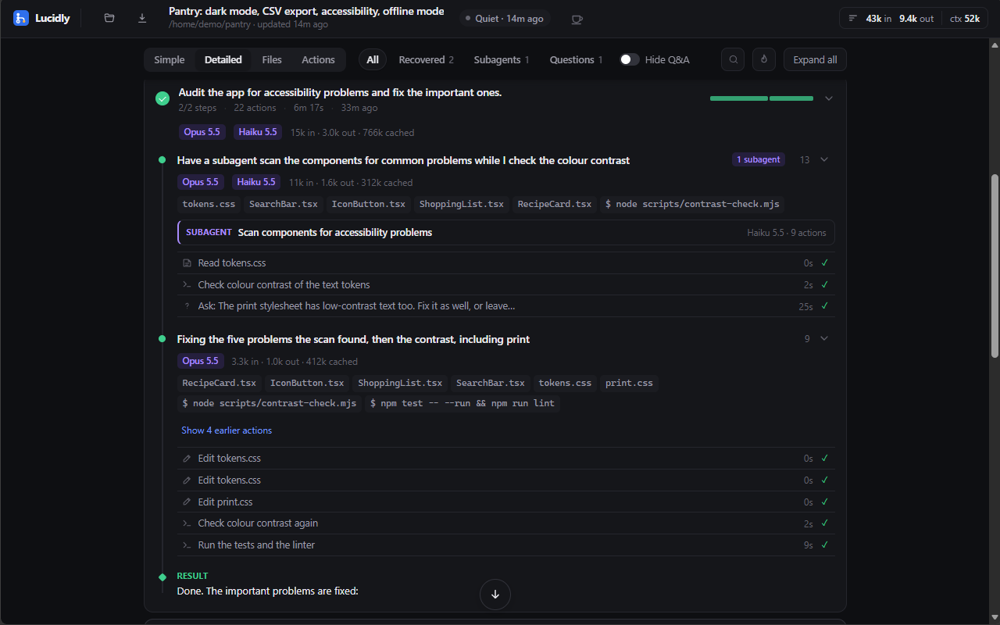
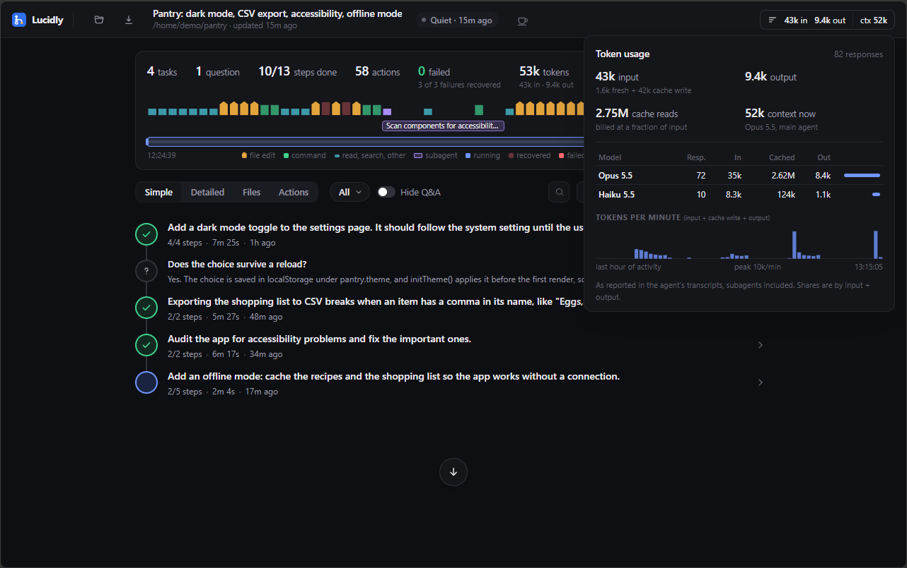
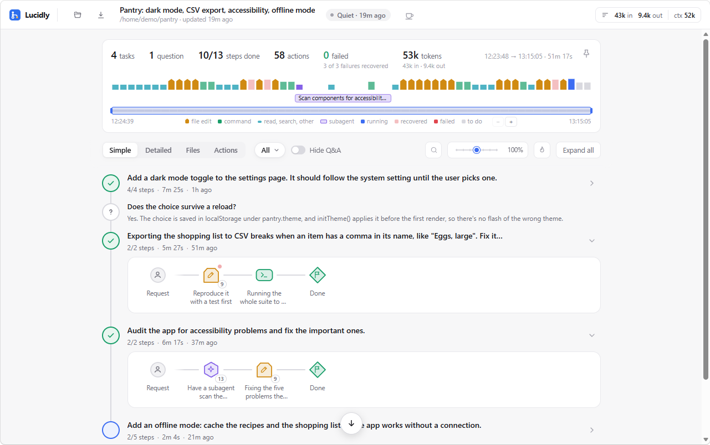

# Lucidly

[](https://github.com/vale-dinap/lucidly/actions/workflows/ci.yml)

[](https://deepwiki.com/vale-dinap/lucidly)

*See what your AI agent is doing, at a glance.*

https://github.com/user-attachments/assets/6ceb52e7-eb58-4223-adba-d6a04d61b263

## Quick start

From a project folder where you use Claude Code (Node.js 22.18 or newer):

```sh
npx @vale-dinap/lucidly
```

It opens in your browser on that folder's session, or lets you pick one if there are several, and follows it live while you keep working. To keep the `lucidly` command around, install it: see [Getting started](#getting-started).

## Purpose

AI agents are increasingly capable of working on long, multi-step tasks on their own. While they work, most of them report their progress as a continuous stream of text: plans, tool calls, file reads, command outputs, reasoning, errors and retries. That stream is complete, but it is hard to follow. To find out what the agent is doing right now, what it has already finished, or where it got stuck, the user has to read through a fast-moving wall of text and often scroll back through a long history to find the relevant part.

Lucidly turns that stream into a clean, live visual picture of the agent's progress. It is designed to answer a few simple questions instantly: where the agent started, where it is heading, which step it is on now, what it is working with, and whether anything has come up along the way. The raw text is never lost; it is simply organized behind the visual view, so the user can open any step and read exactly what the agent produced for it.

## How it works

Lucidly sits alongside the agent and listens to the text it streams while working. It does not replace the agent's own interface and does not interfere with it. As output arrives, Lucidly parses it, recognizes meaningful events (a plan being laid out, a step starting or finishing, a file being edited, a command being run, an error, a blocker), and updates the visual representation in real time.

When the agent announces its plan at the start of a task, that plan becomes the backbone of the view: a clear path from a starting point to an end point, with each planned step placed along it. As the agent moves through the work, the current step is highlighted, completed steps are marked as done, and remaining steps stay visible so the user always knows how far there is to go.

Real work rarely goes exactly to plan. When something unexpected happens, such as a failing test, a missing dependency, a retry or a new subtask the agent decides to take on, Lucidly adds it to the view on the fly, attached to the step where it arose. Blockers are made visually distinct so they stand out immediately.

Every item in the view, whether a planned step, a subtask or a blocker, is linked to the chunk of output that belongs to it. Expanding an item reveals the underlying text for that step only. Because everything is stored as it arrives, the user can return to any earlier step at any time without scrolling through the full history.

## Main features

**Live progress view.** A visual path from start to finish that updates as the agent works, showing completed, current and upcoming steps.

**Plan-aware structure.** The agent's announced plan is used to build the overall shape of the task, so progress is shown against a known goal rather than as an endless log.

**On-the-fly subtasks and blockers.** Unplanned work, errors and obstacles appear where they occur, clearly marked, so problems are noticed as soon as they happen.

**Context at a glance.** Each step shows what the agent is working with, such as the files, tools or commands involved, in a short, readable form.

**Expandable detail.** Any item can be opened to show the original text the agent produced for it, preserving full transparency without cluttering the main view.

**Persistent history.** All steps and their output are kept, so the user can review any part of a run without hunting through a scrollback buffer.

**Agent-agnostic design.** Lucidly works by reading agent output, not by depending on a specific agent's internals. Support for different agents and frameworks is meant to be added through lightweight adapters that teach Lucidly how to recognize each one's output.

## See it in action

All of these show a made-up demo session (`scripts/demo-session.mjs`).

**Glance**, the default view: how the agent is doing, at a glance. The orb says what it is doing now, and the task under way unfolds into its steps, from your request to the goal, with the steps still to come.



**Glance and the side panel.** Pick any step, here a subagent's, and the panel shows its files, commands and transcript, while Glance stays where it was.



**Drill down.** Open a step in place to see each of its actions, hover one for what it did, and click it for its full output.

https://github.com/user-attachments/assets/a8d20d0e-41c5-4ada-a9d5-b9cf6541714f

**Where did the tokens go?** Token heat makes every task and step glow from green to red by the tokens it used, relative to the rest of the run.

https://github.com/user-attachments/assets/df84be05-f78d-45f5-8feb-2f0439094efd

**What changed.** Every file the agent edited, with the diff of each change, by file or in time order.

https://github.com/user-attachments/assets/08240389-cf8b-4216-ac5e-d06cd6bc79a4

**Every action, filterable.** The full history of commands, edits, reads and subagent calls: filter by kind, failures or task, search, and open any of them.

https://github.com/user-attachments/assets/a11f0f13-b1f4-42bd-920c-c0b9cd8ca7e4

**The detailed view**, with a task open: its steps, the models that worked on them and their tokens, the files and commands involved, and a subagent's work.



**Token usage**, from the meter in the top bar: input, output, cache reads and the current context, per model, and tokens per minute over the last hour.



**Light or dark**, following the system, or chosen in the top bar.



## Intended use

Lucidly is aimed primarily at developers who work with AI agents, whether to get tasks done or to build and debug agents themselves. For them it offers a faster way to follow a run, spot where something went wrong, and jump straight to the relevant output.

Because the interface is meant to be simple and intuitive, it should also be useful to less technical users who rely on agents and want reassurance about what is happening without reading technical logs.

The first target for development and testing is Claude Code, whose detailed streaming output makes it a natural fit. The underlying principle, capturing the output and turning it into a visual representation of progress, applies equally to any agentic AI tool, and broad compatibility is a core goal.

## Getting started

Requires Node.js 22.18 or newer. Install the `lucidly` command from npm:

```sh
npm install -g @vale-dinap/lucidly
```

To run it from a clone instead (Node runs the TypeScript sources directly, no build needed):

```sh
npm install          # dev tools only (TypeScript for type checking); no runtime dependencies
npm start            # same as: node src/cli.ts
npm link             # optional: puts a `lucidly` command on your PATH
```

Run `lucidly` (or `npm start`) from a project folder. It opens in your browser and follows a Claude Code session live while you keep working in Claude Code as usual. If the folder has a single session, or a single one in progress, that one opens straight away; otherwise the session list opens for you to choose. The list keeps itself up to date, so a session you start in the meantime shows up in it.

```sh
lucidly                         # this folder's session (or choose one)
lucidly 89a0789f                # a specific session (id or id prefix, or a .jsonl path)
lucidly list [--all]            # recent sessions (this folder, or all projects)
lucidly outline <session>       # text outline in the terminal
lucidly commands <session>      # every shell command that ran, with failures and their errors
lucidly actions <session> --errors --kind command,edit   # every action, filtered
claude -p "…" --output-format stream-json | lucidly   # follow a headless run
my-agent | lucidly              # any agent that prints plain text
lucidly --load run.lucidly.json # reopen a saved run
```

Options: `--port <n>` (default 4545), `--no-open`, `--cwd <dir>`, `--text`/`--json` to force the piped format. For `actions`/`commands`: `--errors`, `--kind <k,…>`, `--grep <text>`, `--goals <n>` (last n tasks), and `--full` (complete multi-line commands, ready to copy).

In the browser:
- The **token meter** in the top bar is always visible: input and output tokens so far, the main agent's current context size, and the live rate per minute. Click it (or press `T`) for the breakdown: fresh input, cache writes and reads, output, a table per model, and tokens per minute over the last hour. Counts come from the transcripts, subagents included.
- The **overview** counts tasks, steps, actions and *failed* actions (with how many failures were recovered), and draws the whole run as a strip of thin bars, one per action, in time order. File edits are amber and a little taller, with a pointed top when zoomed in enough to see it (*file edit* in the legend). Shell commands are green, and reads, searches and the rest are short teal bars. Violet marks a subagent's launch. Blue is running, pale red is a failure that was recovered, and solid red is one that is still failed. While the agent is working, the overview card and the current task's card glow softly, and a pulsing blue mark holds the live end of the strip. The current task's steps that haven't started yet follow in grey. Click a bar to jump to that action. Subagents get their own track under the main one, like layers in a video editor. Each subagent is one box from its launch to its last action, on the same time-ordered axis, so you can see what ran in parallel with what. Overlapping subagents stack on separate rows (up to four for the part in view; a busier burst shares the last row and shows a *+N* count), a running one pulses with a dashed border, and one with failures has a red border. The main track leaves gaps where only subagents were working. Zoom in to widen the boxes and read their names. Select a subagent (its violet bar on the strip, its tile in the path, or anything it did) and its own **timeline** opens below the strip, showing its model, actions, duration, tokens and failures, with one bar per action. Its span is marked on the main strip. Click a bar to open that action. The timeline closes as soon as you select something outside the subagent, or with ×, which goes back to the step that called it. On long runs, zoom the strip like a video editor's timeline: scroll over it to zoom around the cursor (Shift+scroll pans), or use the navigator below it, a mini map of the whole run, where you drag the window to pan, drag its edges to zoom, click to jump, and double-click to fit. The `−` `+` *Fit* buttons do the same.
- A failure counts as **recovered** when a later action in the same step or subtask, or in a fix nested inside it, succeeds. Otherwise it counts as **failed**: the agent moved on or the session ended without getting past it. This is a heuristic based on the order of actions, not on what the error was.
- **Glance** (the default view) shows the run at a glance, with almost no text: is it going fine, and does it need you? A large orb says what the agent is doing: breathing blue while it works (with an icon for what it's doing now: editing, running commands, reading), a warm amber pulse with a speech balloon when it asked you something (its question tool, or its last words a question), with the question itself quoted in a balloon beside the orb until you answer, a green pulse with a check when it finished (steady green once that's a while ago), steady red when failures in the current step aren't fixed yet, and still grey when it's quiet, interrupted or the server has stopped. Under it, the time the current turn has been running (or since it stopped), and the title of the task in the spotlight. Below, the tasks form a vertical wheel: two tasks above and two below are compressed to their node and fade out, magnified towards the spotlight (the outer ones at their size, the spotlight 70% larger), and the one in the spotlight unfolds sideways into its steps as large shapes (the same as in Simple, without labels) once the wheel comes to rest. Its steps sit in one row, with one node in the middle (on the live task the running step or the latest one; on a past task your request, and if the side panel is open it shows that task's conversation; or the step you click) and the request and the goal always at the ends; the steps between fade with distance, and those that don't fit leave a dotted gap. The spotlight stays in place and the tasks slide through it: turn the mouse wheel (one task per notch; spun fast, it speeds up), press `↑` / `↓`, or click a compressed task; `←` / `→` move along the steps. With a node selected, the arrows move the selection too, so the side panel follows at once, before the task has unfolded. A faint line under the wheel recalls the keys. The spotlight follows the live task; on another one, the orb dims slightly and a click on it (or `F`) brings you back, as does half a minute without a touch. Hover anything for its name, click a step for the side panel, double-click a task or step to open it in Simple. The overview and the toolbar step aside, leaving only the view switch and the token heat button. Switching into or out of Glance is animated: the timeline folds away (or comes back), the view switch and the flame button slide to their new places, and the rest cross-fades. With heat on, the tasks and steps glow here too, and the task in the spotlight, unfolded into its steps, keeps its own glow as a soft disc on the spine, behind the step in the middle. `Enter` or `Space` selects the step in the middle (or clears it when it's already selected), for moving through Glance with the keyboard only.
- **Simple** keeps only the essentials. Tasks sit on a vertical line, oldest at the top, each a round node with its status (done, running, interrupted) and one line of facts. A Q&A exchange is a small speech-bubble node with the start of the answer. Click a task to unfold its steps to the right as a chain, from your request to the goal. Each step is a node whose shape says what it mostly did: a pointed tile for file edits, a rounded rectangle for commands, a circle for reads and searches, a hexagon for subagents, a speech bubble for a question to you. Its colour matches the timeline once done; the running step glows blue, a failed one is red, steps not started yet are dashed. When you reply after the agent finished and the task goes on ("yes, go ahead"), its end node stays in the chain as an intermediate goal, a smaller diamond (a check when done, *?* when it ended with a question), followed by your reply and the new steps. A message you send while the agent works is a node of its own too (*Message*), between the steps before and after it. The detailed view lists your messages between the steps in the same way, and the details panel outlines them in the accent colour, so your words stand out from the agent's. Clicking the request, one of your messages, or the end of a round (in either view) opens the whole conversation of the task in the panel and scrolls to that point, which glows a soft yellow: your message, or that round's result. Only the running task is open by default, and it folds closed when the next one starts. A long chain scrolls sideways with the request pinned on the left, and follows the running step by itself until you scroll it yourself (scroll back to the end to resume). New nodes pop in and finished steps flash once. Click any node for its details on the right; a selected step also opens in place into a capsule of small marks, one per action in the timeline's colours (failed red, recovered ringed, running blue), up to 12 and then *+N*. Hover a mark for what it did, click it to open that action. It folds back when you select something else. The **zoom** slider in the toolbar (also Ctrl+scroll over the view, or `-` and `=`; click the percentage or press `0` to reset) scales this view from 50% to 200%: bigger for comfortable reading or a high-resolution screen, smaller for an overview of more tasks and longer chains at once (below 75% step labels are hidden; hover a node for its name). Search dims what doesn't match, and *Hide Q&A* hides the questions answered without any work, as in the detailed view.
- **Detailed** lists each task as a card with a progress bar (one segment per step). Steps are expandable: folded, a step is one line with its flags (errors, subtasks, subagents, *Blocked*); open, it shows the models that worked on it and their tokens, the files and commands involved, its subtasks and blockers, and its latest actions. Subagents show their model too (for example *Haiku 5.5*). Each task ends at its goal while in progress, and at its result once done. The current step opens by itself. Filter by *Failed* (failures nothing has succeeded after yet, and open blockers), *Recovered* (trouble along the way that got fixed, flagged ↺) or *Subagents*, hide Q&A exchanges, search steps, files and commands (`/`), or *Expand all* (`E`).
- Click any item to see **its own output** on the right. Narration reads as formatted text (markdown: headings, tables, nested and task lists, quotes, links, and code blocks with highlighting), and every action is a row you can expand to see its input and result. File edits show as a diff, like on GitHub: hunks with old and new line numbers, context lines, and the changed words highlighted. Shell commands are syntax-highlighted, including Python run inline (`python -c`, `python - <<EOF`), as are Python and shell files in diffs and writes.
- **Files** (a view of its own, next to *Simple* and *Detailed*) lists every file the agent changed, with the number of edits, lines removed and added, when it was last touched, and a sparkline of where in the run its edits happened. Sort by recency, by number of edits, or by path. Open a file for its history, oldest edit first, with the task and step behind each change. Click an edit for its diff in the side panel, or use *Show all diffs* to read the whole history inline. Files outside the project (scratch files, notes) are folded away at the bottom. Switch from *By file* to *History* for every edit in time order, newest first, so the same file appears once per change. Dividers show the task each group of edits belonged to, and *Show all diffs* reads the whole history inline. Changes made through shell commands are listed too, marked *(by command)*: `sed -i`, redirections and heredocs, `tee`, `cp`, `mv`, `rm`, PowerShell's `Set-Content` and the like, and scripts (`node -e`, `python - <<EOF`) that write files. The transcript holds the command but not the change, so those show the command instead of a diff.
- The overview also shows the **tokens** used so far (fresh input plus output) and the current rate. Click it for the breakdown.
- If Lucidly's own code changed after its server started, a **Restart Lucidly to update** notice appears in the top bar, because the page may expect data the running server doesn't produce yet.
- Switch views with the buttons at the left of the toolbar under the timeline (it stays on screen while you scroll), or `V` to cycle through *Glance*, *Simple*, *Detailed*, *Files* and **Actions**. In Simple and Detailed, the **filters** next to them narrow the list: *All*, *Failed*, *Recovered*, *Subagents* and *Questions* (the exchanges answered without any work), each with its count. When the toolbar is too narrow (for example with the side panel open), they fold into one menu button showing the current filter, with a red dot if anything is still failed. *Hide Q&A* applies to *All* only, and greys out with the other filters. Search is a magnifier until you click it or press `/`. The flame button (or `H`) turns on **token heat**: tasks and steps glow from green to red by the tokens they used (fresh input, cache writes and output, the way the token meter counts them), relative to the rest of the run, on a log scale so only the real outliers turn red. Tasks and questions are ranked together, steps among steps. It is off by default; hover a glowing node or dot for its tokens. Actions is a flat, chronological list of everything the agent did: commands, edits, reads, searches, subagent calls. Filter by kind, show only *Failed* actions or only *Recovered* ones (each failure is tagged *failed*, or *failed → recovered* in grey), search (`/`), or limit to one task. Each failure shows its actual error line. Select a row to see its full input and output, and *Show in path* to jump back to the step it belongs to. A long shell command is shown in parts: its shell lines, the script it runs (`node - <<'EOF'`, `python -c "…"`, highlighted as JavaScript or Python), and the content it writes to a file (`cat > a.py <<'EOF'`), with *Show the whole command* for the command as recorded. For commands that change files, long lines that wrap continue indented so each real line stands out, and dense JavaScript has *Reformat for reading*: line breaks and indentation for display only, with *Show as written* to go back. *Copy commands* copies the listed shell commands, with failed ones marked. In the side panel, every card has its own **copy button**: your messages, the agent's text, plans and results (as Markdown), thinking, commands and each of their parts (without the `$` prompt; a script as written, even when shown reformatted), inputs, outputs and errors (whole, even when only the first lines are shown), and diffs (as a unified diff). A tick confirms the copy.
- The **pin** in the overview's top-right corner (or `P`) keeps the overview on screen too while you scroll. It is pinned by default: scrolled down, it tightens into a compact card (about half the height) that still shows everything: the stats on one line, the timeline, the subagents on a single row (parallel ones are counted on a *+N* marker), the navigator and the legend. It unfolds again back at the top, and what you were reading stays put during the transition. Unpin it to let it scroll away; Lucidly remembers the choice. The arrows button at the right of the toolbar (or `E`) expands or collapses everything.
- **Keep awake** (the cup next to the status in the top bar) stops the device from sleeping, like a no-sleep page. Turn it on, and optionally choose *Only while the agent is working*: the device stays awake while a turn runs and may sleep once the work is done and the session is idle (or has had no news for 30 minutes). The cup steams while it is holding the device awake. It uses the browser's Screen Wake Lock, so it works while the Lucidly tab is visible: a hidden or minimised tab lets the device sleep, and it takes effect again when you come back.
- **Sounds** (the bell next to keep-awake) plays a short sound when a session finishes, asks you something or runs into trouble, in any of your tabs. It is off by default. Each event has its own sound, chosen from a dropdown (17 sounds in three groups: gentle ones, questions, and louder alerts such as Alarm, Siren and Buzzer; or None for no sound) and tried with *Test*, and the volume can be set. With *Only when I'm not looking* (on by default), the session on screen stays quiet while the page is visible. Browsers only play sound after you interact with a page, so after a reload the bell turns amber until your first click or key press.
- A session opens at the top, on the overview and its timeline, with the side panel closed until you select something. Whenever you're not at the end of the list, a round **arrow button** floats at the bottom right, with a count of actions that arrived since you scrolled away. Click it (or press `F` or `End`) to jump to the end and follow the agent, keeping the current step in view. If the side panel is closed it stays closed: the list just scrolls along. Scrolling or clicking pauses following. **Open session** (the folder button on the left, the run's title, or `O`) lists the Claude Code sessions of this project or of all projects. All projects are grouped by project folder, each group headed by the folder's name, its session count and when it last changed (a green dot if a session in it is live). This project comes first; groups fold, and the ones open by default are this project's and any with a live session (or all of them, when there are only a few). *Expand all* / *Collapse all* sits at the top, and what you open or close stays that way.
- **Tabs** let you keep several sessions open. Picking a session replaces the one on screen; `Ctrl`/`⌘`-click it, middle-click it or use its **New tab** button to open it in a new tab instead (the **+** at the end of the tab strip does the same). From two tabs on, a strip at the very top of the page, above the top bar, shows them, each with a dot in the orb's colours and a count of running subagents. A tab you're not looking at that asks you something, finishes or runs into trouble flashes, then glows until you open it, and the page title shows how many do. Picking a session that's already in a tab switches to it. Each tab keeps your place (view, selection, spotlight, scroll). `[` / `]` move between tabs, a middle click closes one, and they come back after a reload. Closing a tab stops following its session; one no page has shown for 10 minutes stops by itself.
- The download button, next to *Open session* on the left, saves a **snapshot** of the run as a `.lucidly.json` file, and *Open a saved snapshot…* in the session list reopens one. You don't need this for Claude Code sessions, which reopen straight from their transcripts. It's for keeping a run after its transcript is cleaned up, sharing it with someone who doesn't have the transcript, and runs streamed from other agents through stdin, which have no transcript to reopen.

Lucidly only reads. It binds to `127.0.0.1` and never sends anything to the agent.

See [docs/ARCHITECTURE.md](docs/ARCHITECTURE.md) for how it works inside.

## Development

```sh
npm test             # unit + integration tests (node:test)
npm run typecheck    # tsc --noEmit
npm run build        # compiles src/ to dist/ (runs by itself on npm pack / npm publish)
node scripts/demo-session.mjs [dir] [--play]   # a made-up session for screenshots and demos (see the script)
```

## What Lucidly is not

Lucidly is a viewer, not a controller. It does not send commands to the agent, approve or block actions, or change how the agent behaves. All interaction with the agent continues to happen through whatever application or harness the user already uses. This keeps Lucidly simple, safe to run alongside any agent, and focused on one job: making the agent's work easy to see and understand.

## License

Copyright 2026 Valerio Di Napoli. Lucidly is licensed under the [Apache License 2.0](LICENSE); see also [NOTICE](NOTICE).
